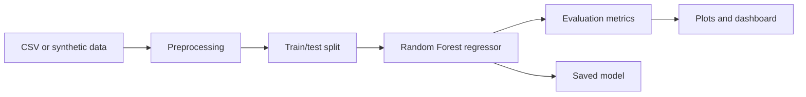

# Burnly

<p align="center">
  <strong>A reproducible tabular regression workflow for calorie-estimation experiments</strong><br/>
  Data preparation, model training, evaluation artifacts, and a lightweight results dashboard.
</p>

<p align="center">
  <a href="https://github.com/HarshithhKumar/Burnly/actions/workflows/ci.yml"></a>
  
  
  
</p>

Burnly is an educational machine-learning project that experiments with estimating calorie expenditure from features such as age, height, weight, exercise duration, and heart rate. It demonstrates how to organize a small regression workflow from data loading to saved model artifacts and evaluation plots.

> **Important:** The current workflow can generate synthetic data. Reported metrics from synthetic data are not evidence of real-world or clinical accuracy, and this project should not be used for health decisions.

## Workflow



## Features

- Synthetic or CSV-based tabular data loading
- Preprocessing and Random Forest regression
- Model artifact export with joblib
- JSON metrics and evaluation plot generation
- pytest tests and a Jupyter notebook walkthrough
- Lightweight HTML dashboard for inspecting results

## Quick start

Requirements: Python 3.9+ and pip.

```bash
git clone https://github.com/HarshithhKumar/Burnly.git
cd Burnly
python -m venv .venv
# Windows PowerShell
.venv\Scripts\Activate.ps1
# macOS/Linux
source .venv/bin/activate
pip install -r requirements.txt
python src/train.py
pytest -q
```

The training script generates outputs such as:

- `artifacts/model.joblib` — trained model
- `artifacts/metrics.json` — evaluation metrics
- `artifacts/evaluation_plot.png` — results visualization
- `data/synthetic_calories.csv` — generated dataset, when synthetic mode is used

## Repository layout

```text
src/train.py                    Data loading, training, and evaluation
tests/test_train.py              Training workflow tests
notebooks/burnly_exploration.ipynb  Exploratory notebook
dashboard.html                   Results dashboard
artifacts/                       Model, metrics, and plots
```

## Evaluation

The training script exports regression metrics, including MAE, RMSE, and R², to `artifacts/metrics.json`. Interpret them only in the context of the dataset and split used. If the pipeline is run on synthetic data, these scores primarily show that the workflow executes; they should not be presented as validated predictive performance.

For a meaningful next evaluation, use a documented real dataset, separate training and test data before fitting preprocessing, compare against a simple baseline, and report the exact split and metrics.

## Explore

- [Notebook walkthrough](notebooks/burnly_exploration.ipynb)
- [Results dashboard](dashboard.html)
- [Training script](src/train.py)
- [Tests](tests/)

## Next steps

- Document the source, schema, and license of a real dataset.
- Add a leakage-safe evaluation protocol and baseline comparison.
- Include error analysis and a clear dataset description alongside reported metrics.

## License

See the repository license file for the applicable terms.
